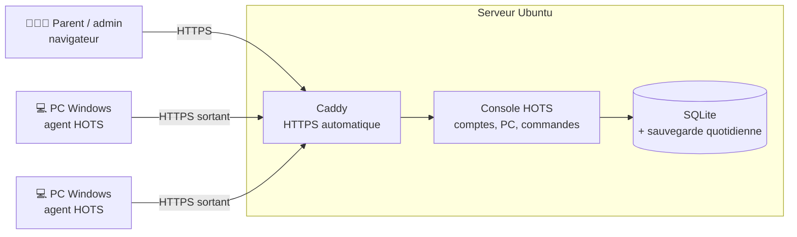

# Console web — administration 100 % à distance de HOTS Hosts

Ce fork ajoute à HOTS Hosts une **console web** : depuis un navigateur (ordinateur ou téléphone),
vous pilotez à distance tous les réglages des PC Windows protégés — contrôle parental, blocages,
confidentialité, fichier hosts — sans jamais vous asseoir devant eux.

Un même serveur accueille **plusieurs clients** (familles, écoles, entreprises…) : chacun a son
compte, ne voit **que ses propres PC** et les administre indépendamment des autres.



- Les PC se connectent **vers** le serveur (connexion sortante HTTPS) : aucun port à ouvrir chez
  vous, ça marche derrière n'importe quelle box, en 4G, à l'école…
- Une modification faite dans la console est appliquée sur le PC en **1 seconde environ**.
- Si le PC est éteint, la modification est **mise en file d'attente** et appliquée à son retour.

---

## Sommaire

1. [Installer le serveur (10 minutes)](#1-installer-le-serveur-10-minutes)
2. [Premier lancement : créer le compte administrateur](#2-premier-lancement--créer-le-compte-administrateur)
3. [Ajouter un PC](#3-ajouter-un-pc)
4. [Utiliser la console](#4-utiliser-la-console)
5. [Plusieurs clients sur le même serveur](#5-plusieurs-clients-sur-le-même-serveur)
6. [Mises à jour, sauvegardes, désinstallation](#6-mises-à-jour-sauvegardes-désinstallation)
7. [Sécurité : comment c'est protégé](#7-sécurité--comment-cest-protégé)
8. [Dépannage](#8-dépannage)
9. [Publier une nouvelle version (mainteneur)](#9-publier-une-nouvelle-version-mainteneur)

---

## 1. Installer le serveur (10 minutes)

### Ce qu'il faut

| | |
|---|---|
| **Un serveur Ubuntu** 22.04 ou 24.04 (Debian 12 fonctionne aussi) | Un petit VPS suffit (1 vCPU, 1 Go de RAM) : OVH, Scaleway, Hetzner, IONOS… comptez 4 à 6 €/mois. |
| **Ports 80 et 443 ouverts** | Dans le pare-feu de l'hébergeur si vous en avez un (le script ouvre ceux du serveur). |
| **Un nom de domaine** *(facultatif)* | Ex. `console.mondomaine.fr`, avec un enregistrement DNS **A** vers l'IP du serveur. Sans domaine, le script crée automatiquement une adresse gratuite du type `51-15-20-30.sslip.io`. |

> 💡 Si votre domaine passe par Cloudflare, laissez le nuage **gris** (pas de proxy) pour
> l'enregistrement de la console : le HTTPS est géré par le serveur, et la fonction « Couper
> Internet » a besoin de connaître l'adresse IP réelle de la console (voir [§7](#7-sécurité--comment-cest-protégé)).

### Installation

1. Téléchargez **`HOTS_Console_Server.zip`** depuis la page
   [Releases](https://github.com/jrsmrtn/HOTS-Web-Administrated/releases/latest).
2. Copiez-le sur le serveur et lancez l'assistant :

```bash
wget https://github.com/jrsmrtn/HOTS-Web-Administrated/releases/latest/download/HOTS_Console_Server.zip
```

```bash
sudo apt install -y unzip && unzip HOTS_Console_Server.zip && cd HOTS_Console_Server
```

```bash
sudo ./deploy.sh
```

3. Laissez-vous guider : l'assistant s'affiche en **fenêtres** dans le terminal (flèches + Entrée).
   Il vous demande seulement l'adresse de la console (votre domaine, ou adresse automatique) et,
   facultativement, un e-mail pour Let's Encrypt. Il installe ensuite tout seul :
   - l'application et son environnement Python isolé (`/opt/hots-console`) ;
   - le service `hots-console` (redémarrage automatique, protections systemd) ;
   - **Caddy**, qui obtient et renouvelle le certificat **HTTPS** automatiquement ;
   - une **sauvegarde quotidienne** de la base (`/var/backups/hots-console`, 14 jours).

4. À la fin, un **lien** (et un QR code) s'affiche : c'est l'étape suivante.

<details>
<summary><strong>Installation sans questions (automatisation)</strong></summary>

```bash
sudo ./deploy.sh --domain console.mondomaine.fr --email moi@mondomaine.fr --yes
```

```bash
sudo ./deploy.sh --sslip --yes
```

Le lien de configuration est affiché à la fin, et à tout moment avec `sudo hots-server setup-link`.
</details>

---

## 2. Premier lancement : créer le compte administrateur

Ouvrez le lien affiché par `deploy.sh` (`https://votre-console/#/setup/…`). Un assistant en
3 étapes vous demande :

1. le **nom de la console** (ex. « Console famille Martin ») ;
2. **votre compte administrateur** (nom, e-mail, mot de passe d'au moins 10 caractères) ;
3. **comment vos clients obtiennent un compte** : créés par vous (recommandé) ou inscription libre.

> Ce lien ne fonctionne qu'une fois : sans lui, personne d'autre ne peut prendre le contrôle de
> votre serveur entre son installation et votre première connexion.

---

## 3. Ajouter un PC

Dans la console : **Mes PC → Ajouter un PC**. Une fenêtre affiche l'adresse de la console et un
**code d'ajout** (ex. `P7QF-PA2Z`, valable 7 jours, utilisable pour plusieurs PC). Ensuite, sur
le PC à protéger :

### Nouvelle installation (le plus simple)

1. Téléchargez **`HOTS_Hosts_setup.exe`** (bouton « Télécharger l'installateur » de la fenêtre).
2. Lancez-le. À l'étape **« Administration à distance »**, collez l'**adresse** et le **code**.
3. Terminez l'installation : le PC apparaît dans la console en quelques secondes
   (la fenêtre de la console affiche « ✅ Nouveau PC détecté »).

### HOTS Hosts est déjà installé

Ouvrez HOTS Hosts → **Options → Administration à distance**, saisissez l'adresse et le code,
cliquez **Relier ce PC**. (Ou relancez simplement le nouvel installateur : il met à jour le
programme sans rien perdre et propose la même étape.)

### Déploiement sur plusieurs PC (informaticiens)

```bat
HOTS_Hosts_setup.exe /VERYSILENT /SERVER=https://console.mondomaine.fr /CODE=P7QF-PA2Z
```

### Ce qui est installé sur le PC

Un **agent** (`HOTS Remote Agent.exe`, dans le dossier du programme) démarré par une tâche
planifiée **au démarrage de Windows, en compte SYSTÈME** : il fonctionne même quand personne
n'est connecté, et un compte enfant (utilisateur standard) ne peut ni l'arrêter, ni lire ses
identifiants, ni le rediriger vers un autre serveur.

---

## 4. Utiliser la console

Le **tableau de bord** liste vos PC : en ligne / hors ligne, dernière connexion, et un résumé des
protections actives. Cliquez un PC pour l'administrer :

| Onglet | Ce que vous pouvez faire à distance |
|---|---|
| **Contrôle parental** | Bloquer 15 catégories (TikTok, YouTube, réseaux sociaux, adultes, jeux, rencontres…), filtre DNS familial Cloudflare, votre propre liste de sites bloqués. |
| **Protections** | Verrouiller le fichier hosts, **couper Internet** (la console reste joignable pour le rétablir), bloquer les VPN, bloquer la restauration du système, bloquer le « DNS sécurisé » de chaque navigateur. |
| **Applications** | Bloquer n'importe quel programme, ou le choisir dans la liste des programmes installés ; suspendre / retirer un blocage. |
| **Confidentialité** | Les 4 niveaux de réglages anti-télémétrie de Windows, réglage par réglage ; vérifier que Windows ne les a pas annulés ; créer un point de restauration. |
| **Fichier hosts** | Tableau des entrées (recherche, ajout, modification, activation, suppression), édition en texte brut, sauvegardes et restauration. |
| **Outils** | Infos du PC (Windows, durée d'allumage…), renommer, notes, vider le cache DNS, retirer le PC de la console. |
| **Journal** | Historique de chaque action : qui, quand, résultat, durée. |

Bon à savoir :

- **PC hors ligne** : la console affiche son dernier état connu ; vos modifications sont
  programmées et s'appliquent dès son retour (bandeau « en attente »).
- **Fichier hosts verrouillé** : les modifications faites depuis la console le déverrouillent
  une fraction de seconde puis le reverrouillent automatiquement.
- Quelques réglages de confidentialité dépendent de la **session de l'utilisateur** (identifiant
  publicitaire, recherche Bing…) : ils s'affichent avec le badge « Session utilisateur » et se
  règlent dans l'application sur le PC.
- La console s'utilise aussi sur **téléphone**, et suit le thème clair/sombre de l'appareil.

---

## 5. Plusieurs clients sur le même serveur

Menu **Administration** (visible par l'administrateur du serveur uniquement) :

- **Nouveau client** : nom du compte, e-mail, mot de passe initial (généré), limite de PC
  facultative. La fenêtre de confirmation donne le texte à transmettre au client.
- Pour chaque client : nombre de PC (en ligne / total), **suspendre** / réactiver, réinitialiser
  un mot de passe, modifier la limite de PC, supprimer.
- **Réglages** : nom de la console, lien de téléchargement de l'installateur, inscription libre.

Isolation : un client ne voit **que** ses PC, ses codes d'ajout et son journal. L'administrateur
du serveur gère les comptes, mais ne pilote pas les PC des clients depuis l'interface.

Dans **Mon compte**, chaque client peut ajouter d'autres personnes à son compte (ex. l'autre
parent : chacun son identifiant, mêmes PC), gérer ses codes d'ajout, changer son mot de passe et
consulter le journal d'activité (connexions, PC ajoutés…).

---

## 6. Mises à jour, sauvegardes, désinstallation

Le menu de gestion du serveur :

```bash
sudo /opt/hots-console/deploy.sh
```

| Besoin | Comment |
|---|---|
| **Mettre à jour la console** | Téléchargez et dézippez la nouvelle version, puis `sudo ./deploy.sh` → « Mettre à jour ». Une sauvegarde est faite avant ; comptes et PC sont conservés. |
| **Mettre à jour les PC** | HOTS Hosts → Options → Mises à jour (il télécharge l'installateur de ce fork), ou relancez le nouvel installateur. La liaison à la console est conservée. |
| **Sauvegarde manuelle** | Menu → « Faire une sauvegarde maintenant » (ou `sudo hots-server backup /var/backups/hots-console`). |
| **Restaurer une sauvegarde** | `sudo systemctl stop hots-console`, copiez le fichier `hots-AAAAMMJJ-HHMMSS.db` sur `/var/lib/hots-console/hots.db` (propriétaire `hots`), puis `sudo systemctl start hots-console`. |
| **Mot de passe oublié** | Menu → « Réinitialiser le mot de passe d'un utilisateur » (ou `sudo hots-server reset-password e-mail`). |
| **Changer d'adresse** | Menu → « Changer l'adresse ». Les PC déjà reliés devront être reliés à nouveau si l'ancienne adresse ne répond plus. |
| **Désinstaller** | Menu → « Désinstaller » (les données sont conservées par défaut). |

---

## 7. Sécurité : comment c'est protégé

**Sur le PC**

- L'agent n'exécute qu'une **liste fermée de 26 actions** (activer une catégorie, bloquer une
  application, modifier une entrée hosts…). Il n'existe **aucune** commande « exécuter un
  programme » ou « écrire un fichier quelconque » : même un serveur compromis ne peut pas s'en
  servir pour prendre la main sur les PC.
- Identifiants de l'agent stockés dans `C:\ProgramData\HOTS Hosts` (accès réservé aux
  administrateurs et à SYSTÈME). Connexion **HTTPS uniquement** (certificats vérifiés).
- **Couper Internet** laisse joignable la seule adresse IP de la console (pour pouvoir rétablir
  Internet à distance) ; l'agent mémorise cette IP au cas où le DNS serait inaccessible. Si la
  console est derrière un proxy/CDN partagé (ex. Cloudflare « nuage orange »), ce passage serait
  ouvert à d'autres sites : préférez une IP dédiée.
- Retirer un PC de la console révoque immédiatement ses identifiants ; ses protections restent en
  place sur le PC.

**Sur le serveur**

- Mots de passe hachés (PBKDF2-SHA256, 600 000 itérations), cookies de session `HttpOnly`,
  `Secure`, `SameSite=Strict`, protection CSRF, limitation des tentatives de connexion et
  d'ajout de PC, en-têtes de sécurité stricts (CSP sans script externe).
- Le service tourne sous un utilisateur dédié sans privilèges, avec les protections systemd
  (`ProtectSystem=strict`, `NoNewPrivileges`…), derrière Caddy (HTTPS, HSTS).
- Les codes d'ajout expirent (1 à 90 jours) et peuvent être révoqués.

**Limites à connaître** : voir l'audit détaillé
[AUDIT_CONTROLE_PARENTAL.md](AUDIT_CONTROLE_PARENTAL.md) (navigateurs portables, partage de
connexion du téléphone, compte enfant administrateur…) et son plan d'amélioration.
Recommandation n°1 : l'enfant doit utiliser un **compte Windows standard**, jamais administrateur.

---

## 8. Dépannage

| Symptôme | Que faire |
|---|---|
| Le certificat HTTPS ne s'obtient pas | Le domaine doit pointer vers l'IP du serveur et les ports 80/443 être ouverts (pare-feu de l'hébergeur). `sudo journalctl -u caddy -n 50` |
| La console ne répond pas | `sudo systemctl status hots-console` puis `sudo journalctl -u hots-console -n 50` |
| Le PC reste « hors ligne » | Sur le PC : Options → Administration à distance indique l'état de l'agent. Journal : `C:\ProgramData\HOTS Hosts\remote_agent.log`. Vérifiez que le PC accède à l'adresse de la console dans un navigateur. |
| « Code d'ajout invalide ou expiré » | Générez un nouveau code (Mon compte → Codes d'ajout, ou bouton « Ajouter un PC »). |
| « Nombre maximal de PC atteint » | L'administrateur du serveur peut relever la limite (Administration → icône réglages du client). |
| Plus de lien de configuration | `sudo hots-server setup-link` |

### Essayer la console sans PC Windows (démo)

Un PC Windows simulé permet de tester la console (développement, démonstration) :

```bash
python3 server/tools/demo_agent.py --server https://votre-console --code VOTRE-CODE --name PC-DEMO
```

---

## 9. Publier une nouvelle version (mainteneur)

1. Mettez à jour le numéro de version **à deux endroits** (identiques) :
   `hosts_editor/version.py` (`APP_VERSION`) et `setup.iss` (`MyAppVersion`).
2. Poussez un tag correspondant :

```bash
git tag v2.5.1 && git push origin v2.5.1
```

3. Le workflow **Build and Release** vérifie les numéros de version, construit
   `HOTS_Hosts_setup.exe` (Windows, Nuitka + Inno Setup, avec l'agent), teste et empaquette
   `HOTS_Console_Server.zip`, puis publie la release avec `SHA256SUMS.txt`.

Développement du serveur en local :

```bash
cd server && python3 -m venv .venv && .venv/bin/pip install -r requirements.txt pytest httpx
```

```bash
.venv/bin/python -m pytest -q tests
```

```bash
HOTS_DATA_DIR=./data .venv/bin/python -m hots_server serve --port 8080
```

Structure :

```
hosts_editor/remote/        agent Windows (liste blanche d'actions, boucle de connexion, tâche planifiée)
server/hots_server/         serveur (Starlette + SQLite) et console web (static/)
server/deploy/deploy.sh     installation / mise à jour / désinstallation sur Ubuntu
server/tests/               tests API + test de bout en bout agent ↔ serveur
server/tools/demo_agent.py  PC Windows simulé
```
